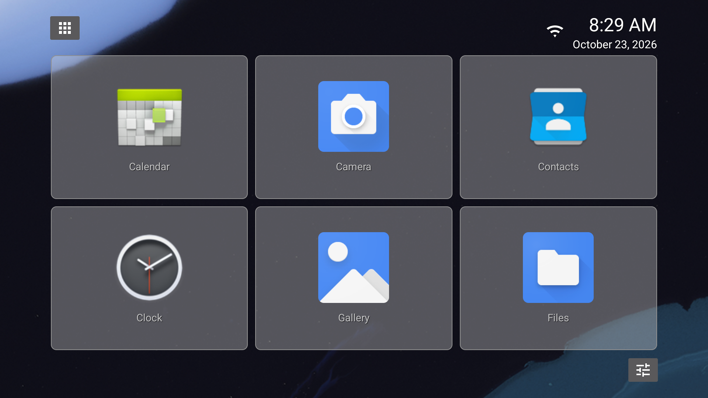

# Simple TV Launcher

A lightweight Android TV launcher designed for remote controls, including older
TV boxes running Android 4.0 or later.

## Features

- [Customizable home grid](docs/home.md): tile size, labels, transparency and icon locking.
- [Applications, shortcuts and folders](docs/home.md#applications-shortcuts-and-folders), including a tile for the TV's original launcher.
- [PIN protection and hidden applications](docs/protection.md).
- [System wallpaper or a custom home image](docs/wallpaper.md), with fit and crop modes.
- [Clock with optional date, battery and network information](docs/home.md#status-information).

[Build from source](docs/building.md)
